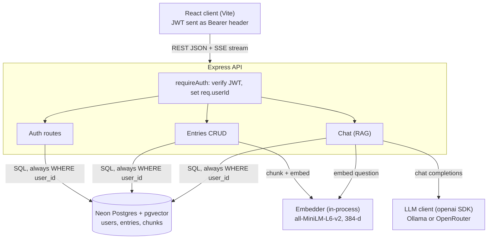

# AI Journal: a personalized RAG journal

Write private daily journal entries, then ask an AI assistant questions about them ("What did I eat for breakfast on Tuesday?"). Answers come **only** from your own entries, with citations to the dates they came from.

- **Auth:** sign up / log in with email + password; JWT sessions.
- **Journal CRUD:** create, list, edit and delete entries.
- **RAG chat:** your question is embedded, matched against **your** entries in a hosted vector database (Neon Postgres + pgvector), and the best excerpts are sent to an LLM that answers from them.
- **Swappable LLM:** local **Ollama** or cloud **OpenRouter**, chosen by environment variables, with no code changes.
- **Stretch goals:** all three are implemented: streaming answers (token by token over SSE), edit/delete sync with the vectors, and source citations.

Demo video: _add link here_

---

## Architecture



| Layer | Choice |
| --- | --- |
| Frontend | React 18 + Vite, plain CSS |
| Backend | Node.js 20+, Express 5, plain JavaScript (ES modules) |
| Database + vector store | Neon serverless Postgres with the `pgvector` extension (HNSW index) |
| Embeddings | `Xenova/all-MiniLM-L6-v2` (384 dimensions), run in-process with `@huggingface/transformers` |
| LLM | Any OpenAI-compatible API through the `openai` SDK: Ollama (local) or OpenRouter (cloud) |
| Validation | `zod` (env vars at boot and every request body) |

Request layering: `routes` → `controllers` (HTTP only) → `services` (business logic) → `repositories` (the only SQL) → Postgres.

---

## Run it locally

### Prerequisites

- **Node.js 20.6+** (uses the built-in `--env-file` flag)
- A free **[Neon](https://neon.tech)** account
- Either **[Ollama](https://ollama.com)** installed locally, **or** a free **[OpenRouter](https://openrouter.ai)** API key

### 1. Clone and install

```bash
git clone <this-repo-url> ai-journal
cd ai-journal
cd server && npm install
cd ../client && npm install
```

### 2. Create the database (Neon)

1. Create a Neon project.
2. Open **Connect**, turn on **Connection pooling**, and copy the connection string. It contains `-pooler`. Change `sslmode=require` to `sslmode=verify-full`: it is what `pg` already does today (full certificate check), and it avoids `pg`'s deprecation warning.

### 3. Configure the server

```bash
cd server
cp .env.example .env
```

Edit `server/.env`:

- `DATABASE_URL`: the pooled Neon connection string.
- `JWT_SECRET`: a long random string. Generate one with
  `node -e "console.log(require('crypto').randomBytes(32).toString('hex'))"`
- Choose the LLM provider (step 5).

### 4. Create the tables

```bash
npm run db:migrate
# -> Schema applied. pgvector version: 0.8.x
```

This runs [`server/src/db/schema.sql`](server/src/db/schema.sql), which enables pgvector and creates the `users`, `entries` and `chunks` tables and their indexes. It is safe to run more than once.

### 5. Choose an LLM provider

**Option A: Ollama (local, private).** This is the default in `.env.example`.

```bash
ollama pull llama3.2:3b     # ~2 GB; use llama3.2:1b on machines with < 8 GB RAM
```

Make sure the Ollama app is running.

**Option B: OpenRouter (cloud).** In `server/.env`, comment out the Option A block and uncomment Option B, then set `LLM_API_KEY` (create one at openrouter.ai/settings/keys; a credit limit of 0 keeps it free-only). The default is `poolside/laguna-s-2.1:free`. Free models change over time and are often rate-limited, so `LLM_FALLBACK_MODELS` lists backups that OpenRouter tries automatically (filter "free" at openrouter.ai/models for current ones).

### 6. Start the API

```bash
npm run dev        # in server/
```

```
[INFO] Postgres connected
[INFO] LLM provider: ollama, model: llama3.2:3b, base URL: http://localhost:11434/v1
[INFO] API listening on http://localhost:4000
[INFO] Embedding model ready: Xenova/all-MiniLM-L6-v2 (384d)
```

The first start downloads the embedding model (~23 MB) once.

### 7. Start the web client

```bash
cd client
cp .env.example .env     # VITE_API_URL=http://localhost:4000
npm run dev
```

Open http://localhost:5173, sign up, write an entry and ask about it.

### Tests and checks

```bash
cd server
npm test                   # unit tests for the chunker and the date parser (node:test)
npm run check:isolation    # with the API running: proves user A's data is invisible to user B
```

---

## LLM provider abstraction

The LLM layer is a thin adapter over the **OpenAI Chat Completions protocol**. Ollama (`http://localhost:11434/v1`) and OpenRouter (`https://openrouter.ai/api/v1`) both implement it, so a single `openai` SDK client with a configurable `baseURL`, `apiKey` and `model` talks to either one. [`providers.js`](server/src/services/llm/providers.js) is a small registry of presets per provider (base URL, default model, whether a key is required, OpenRouter's attribution headers). [`llmClient.js`](server/src/services/llm/llmClient.js) merges the preset chosen by `LLM_PROVIDER` with any `LLM_BASE_URL` / `LLM_API_KEY` / `LLM_MODEL` overrides, validates the result at startup (for example, a missing OpenRouter key stops the boot with a clear error), and builds one client.

The rest of the backend depends only on two functions: `llm.chat(messages)` and `llm.streamChat(messages)`, an async generator of tokens. Provider-specific details stay inside the adapter: failures (Ollama not running, a 429 from OpenRouter) become one `LlmError` type, and for OpenRouter an optional `LLM_FALLBACK_MODELS` list is sent as its `models` parameter, so a rate-limited free model fails over to the next one (the log shows which model actually answered). Switching between local, privacy-first inference and cloud models is a `.env` change and a restart. Any other OpenAI-compatible server (LM Studio, vLLM, Groq) works the same way, and a provider with a different protocol would only need a new adapter that exposes the same two functions.

---

## Multi-tenancy and data isolation

Every user's data is isolated at several independent layers, so one mistake does not expose anything:

1. **Identity comes only from the verified JWT.** [`requireAuth`](server/src/middleware/requireAuth.js) verifies the token's signature and expiry and sets `req.userId`. No route ever reads a user id from the body, query string or URL.
2. **All SQL lives in repositories that require `userId`.** Every function in [`entryRepo`](server/src/repositories/entryRepo.js) and [`chunkRepo`](server/src/repositories/chunkRepo.js) takes `userId` as its first argument, refuses to run without it, and every statement filters on it (`WHERE id = $1 AND user_id = $2`). An entry that exists but belongs to someone else returns **404, not 403**, so its existence isn't revealed. Ids are random UUIDs, so they can't be guessed.
3. **The vector search is scoped inside the same SQL statement:**
   ```sql
   SELECT ..., 1 - (embedding <=> $2::vector) AS score
   FROM chunks
   WHERE user_id = $1
   ORDER BY embedding <=> $2::vector
   LIMIT 5;
   ```
   The tenant filter and the similarity ranking are one query, so Postgres can only return rows that satisfy `user_id = $1`, whichever index plan it picks. The plan can affect *recall* but never *whose* rows come back. On pgvector ≥ 0.8 the query enables `hnsw.iterative_scan`, so the HNSW index keeps searching until enough of this user's rows are found.
4. **The database enforces ownership.** `user_id` is stored on every chunk, and a composite foreign key `(entry_id, user_id) REFERENCES entries (id, user_id)` makes Postgres reject any chunk whose owner differs from its entry's owner. `ON DELETE CASCADE` removes an entry's vectors together with the entry.
5. **Defence in depth.** After retrieval, [`retriever.js`](server/src/services/rag/retriever.js) asserts that every chunk belongs to the requester and fails loudly if not.

[`scripts/isolationCheck.js`](server/scripts/isolationCheck.js) proves this end to end against a running server. It creates two users, stores a secret for user A, and checks that B's chat cannot retrieve it, that B gets 404 when reading, editing or deleting A's entry, and that missing or tampered tokens get 401.

---

## The RAG pipeline

**Ingestion** (`POST /api/entries`): the entry text is split into chunks ([`chunker.js`](server/src/services/rag/chunker.js)). Each chunk is prefixed with its date (`Journal entry from Tuesday, 14 October 2026:`) and embedded in one batch. The entry and its chunks are then written in **one transaction**. Embedding happens *before* the transaction, so a failure leaves nothing half-written. Editing re-chunks and replaces the vectors in the same transaction as the text change, and deleting cascades.

**Chunking strategy:** most journal entries are short and are embedded whole. Longer ones are split on paragraph boundaries, then sentence boundaries, into chunks of at most **800 characters**, with the previous chunk's last sentence carried over as overlap. The 800-character limit comes from the embedding model: MiniLM reads at most 256 word-pieces (~1,000 characters) and silently truncates the rest. Adding the date to the embedded text lets questions like "on Tuesday" match the right entry, which plain semantic embeddings can't do on their own.

**Retrieval** (`POST /api/chat`): the question is embedded with the same model, then the 5 nearest chunks are fetched with the user-scoped SQL above. Chunks below a cosine-similarity threshold (`RAG_MIN_SCORE`, default 0.35) are dropped. If nothing is left, the API replies "I couldn't find anything about that in your journal" **without calling the LLM**, which prevents made-up answers and saves quota.

**Date-aware retrieval (hybrid search):** vector similarity captures meaning but is weak at exact values. "What did I eat on 1 October?" is semantically close to *every* food entry, whatever its date. So [`dateParser.js`](server/src/services/rag/dateParser.js), a pure and unit-tested function, looks for a date or period in the question ("1 October", "yesterday", "last Sunday", "last week", "in September", "last year") and resolves it against the user's local date. When it finds one, the same user-scoped vector query adds `AND entry_date BETWEEN $4 AND $5`, so only entries from that period are ranked. The prompt then tells the model the date condition is already satisfied (small models otherwise misjudge whether "6 August 2025" is "last year"). If the period has no entries, retrieval falls back to plain semantic search, and the model is told that nothing exists for that date, so it won't present another day's entry as the answer.

**Generation:** [`promptBuilder.js`](server/src/services/rag/promptBuilder.js) puts the excerpts, numbered `[1]..[n]` with their dates, into the system message, along with today's date (sent by the browser, so "yesterday" uses the user's time zone). The model is told to answer only from the excerpts, to cite them, and to treat them as data rather than instructions. The answer is streamed back as Server-Sent Events: a `sources` event first (the real list of retrieved entries, so citations are reliable even if the model forgets them), then `token` events, then `done`.

The server log shows every step (useful for the demo):

```
[RAG] question from user fe01e86b-...: "What is my secret code word for the locker?"
[RAG] question embedded (384d) {"ms":3}
[RAG] vector search WHERE user_id=fe01e86b-...: 1 nearest chunks, 1 above min score 0.35 {"ms":5}
[RAG]   #1 keep score=0.719 date=2026-10-18 "My secret code word for the locker is PINEAPPLE-8323. Do not..."
[LLM] sending 1 excerpts to ollama {"model":"llama3.2:3b","promptChars":593}
```

---

## API

All endpoints except health, signup and login require `Authorization: Bearer <token>`. Errors always have the shape `{ "error": { "code", "message", "details"? } }`.

| Method + path | Body | Response |
| --- | --- | --- |
| `GET /api/health` | | `{ ok, llmProvider, llmModel, embeddingModel }` |
| `POST /api/auth/signup` | `{ email, password }` | `201 { token, user }` |
| `POST /api/auth/login` | `{ email, password }` | `{ token, user }` |
| `GET /api/auth/me` | | `{ user }` |
| `GET /api/entries` | | `{ entries }` (own entries, newest first) |
| `POST /api/entries` | `{ content, entryDate? }` | `201 { entry, chunkCount }` |
| `PUT /api/entries/:id` | `{ content, entryDate? }` | `{ entry, chunkCount }` |
| `DELETE /api/entries/:id` | | `204` |
| `POST /api/chat` | `{ question, today? }` | SSE stream: `sources`, `token`..., `done` (or `error`) |

---

## Project structure

```text
server/
  src/
    server.js              entry point: DB check, embedder warm-up, listen
    app.js                 Express app: middleware + routes
    config/env.js          zod-validated configuration (the only reader of process.env)
    db/                    pg pool + withTransaction, schema.sql, migrate.js
    repositories/          ALL SQL; every function is scoped by userId
    middleware/            requireAuth, validate, rate limits, error handler
    routes/ controllers/   HTTP wiring
    services/
      auth.service.js      bcrypt + JWT
      entry.service.js     entry CRUD + vector sync (transactions)
      embeddings/          in-process embedding model
      llm/                 provider registry + OpenAI-compatible client
      rag/                 chunker, ingest, dateParser, retriever, promptBuilder, ragService
    utils/                 logger, errors, SSE helper, dates
  scripts/isolationCheck.js
  test/                    chunker + dateParser unit tests
client/
  src/api/client.js        fetch wrapper + SSE stream reader
  src/hooks/useAuth.js
  src/components/          AuthForm, EntryForm, EntryList, Chat
```

---

## Deployment (optional, all free tiers)

- **API on Render** (free web service): root directory `server`, build `npm ci`, start `npm start`. Set the same variables as `.env` (use the OpenRouter option, since Render can't reach Ollama on your machine), with `CLIENT_ORIGIN` set to the frontend URL. Run `npm run db:migrate` once from your machine first.
- **Client on Vercel**: root directory `client`, framework Vite, `VITE_API_URL` = the Render URL.
- Neon needs no IP allow-list: the connection is protected by TLS and the password in `DATABASE_URL`.

## Known limitations and next steps

- The date parser is rule-based (English phrases such as "1 October", "last week", "in 2025"). Unusual phrasings ("the week before Diwali") fall back to plain semantic search. Next: let the LLM extract the date range as structured output.
- Single-turn chat: follow-up questions aren't rewritten into standalone ones before retrieval.
- Pure vector search can miss exact tokens (rare names, codes). Next: hybrid search with Postgres full-text search.
- Embedding runs inside the request (fine at journal scale). Next: a job queue for bulk imports.
- Isolation is enforced in application code + foreign keys. Next: Postgres row-level security as a database-level backstop.
- The JWT is kept in `localStorage` (works across the Vercel/Render domains). Production: httpOnly SameSite cookies on a shared domain.
- Auth is email + password with server-side validation (email format; password ≥ 8 characters, ≤ 72 bytes for bcrypt, not a common password, not containing the email name). Not implemented: email verification, password reset, token revocation on logout (a token stays valid until it expires; production would use short-lived access tokens + refresh tokens), and per-account lockout (rate limiting is per IP).
- Development logs include truncated journal text for demonstration. Production would redact it.
